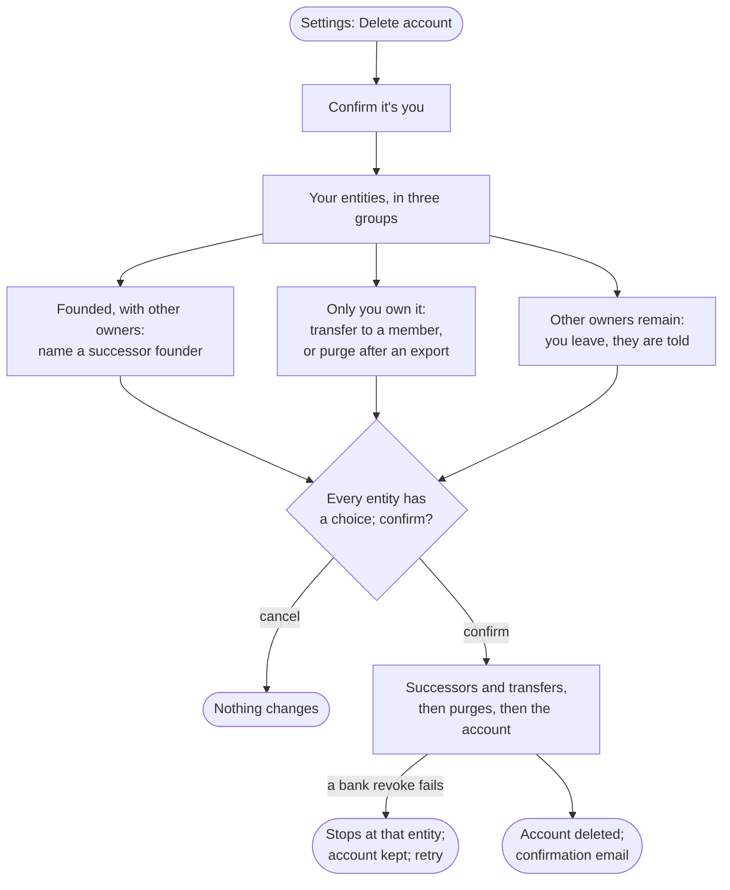

# Flow: Account deletion

**Story (PRD §5):** As a user leaving the instance, I want to decide what happens to every entity I hold before anything is removed, so that no entity is orphaned and nothing is purged by surprise.

**Notes**
- **Choices first, effects last.** One dialog collects every choice; nothing applies until **Delete my account**, which stays unavailable until every entity has a choice and asks for the second step. Cancel at any point changes nothing. Transfer is never preselected.
- **1. Name a successor founder.** For each entity the user founded that has other owners: a select among those owners, with one line on why ("The founder breaks a deadlock over removing a co-owner, so someone must hold it."). An entity the user co-owns but did not found needs no step.
- **2. Entities only you own.** Each takes **Transfer to a member…** (that member becomes owner and founder) or **Purge, after an export**. The transfer select lists the entity's members; one without a second step is listed disabled, "needs a second step", because the new owner must hold owner in force. With no member eligible, only Purge is offered. A purge choice shows its export once ready, with the ledger fingerprint line, or "none, no entries are posted yet" for an entity with no posted entries.
- **3. Entities you leave.** Listed by name, with the note that their other owners are notified.
- **A failed bank revoke stops the run** at that entity: entities already purged stay purged, the rest are untouched, the account is kept, and the user sees which entity stopped it.
- **The plan belongs to this sign-in.** Another session, or signing in again, starts from the list; if the 5-minute check lapses mid-run, Confirm it's you appears again.
