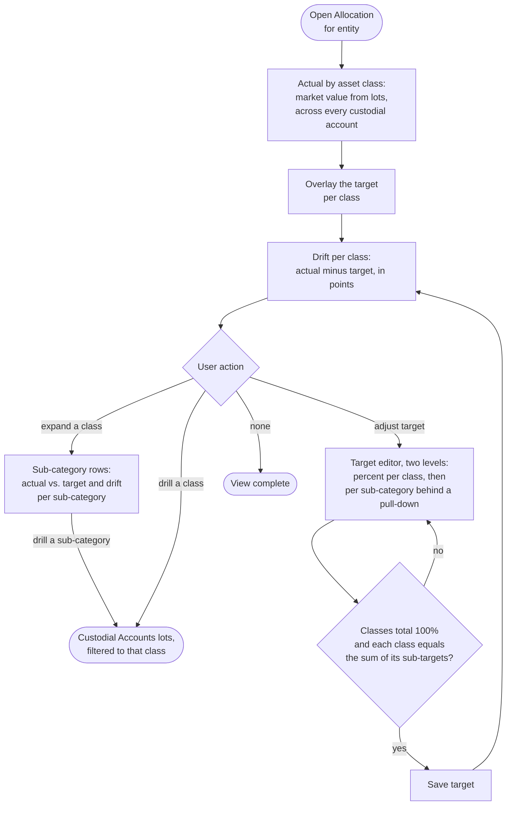

# Flow: Allocation vs. target

**Story (PRD §4.8):** an asset-allocation view with target adjustments, so actual holdings compare to where I want them.

**Notes**
- **Same data, different aggregation:** actual allocation is the lots' market value summed by asset class across every custodial account for the entity — not a new data source.
- **Drift is information, not a warning.** Over or under target shows as a neutral `outline` badge ("+2 pt over", "−2 pt under"); on target shows the positive soft badge. No caution or danger hue.
- **Drill:** each asset-class or sub-category name opens Custodial Accounts' lots, filtered to it, so every percentage traces to the lots behind it.
- **Sub-categories behind a pull-down.** Every class row, in the chart and in the target editor, has a chevron that reveals its sub-categories (the lots sub-card's disclosure pattern). Seeded defaults: US Equity → Large cap, Mid/Small cap; Intl Equity → Developed, Emerging; Fixed Income → Treasuries, Corporate, Municipal; Cash → Cash, Money market. In the chart, each sub-row shows its own actual / target and drift badge.
- **Target editor, two levels:** sub-targets are whole-portfolio percent and must sum to their class target; the class row stays editable and carries a reconcile badge (positive soft "Sub-targets sum to N%", or neutral outline "N pt unassigned"). Save is enabled only when the classes total 100% and every class reconciles. Viewers see the chart but no editor and no Save (write controls are omitted, not greyed).
- **No nominal / inflation-adjusted toggle here.** Allocation is a contemporaneous snapshot of today's holdings, so a CPI-U restatement adds no information; the toggle (PRD §4.10) belongs to the time-series views (Dashboard net-worth chart, Reports).
