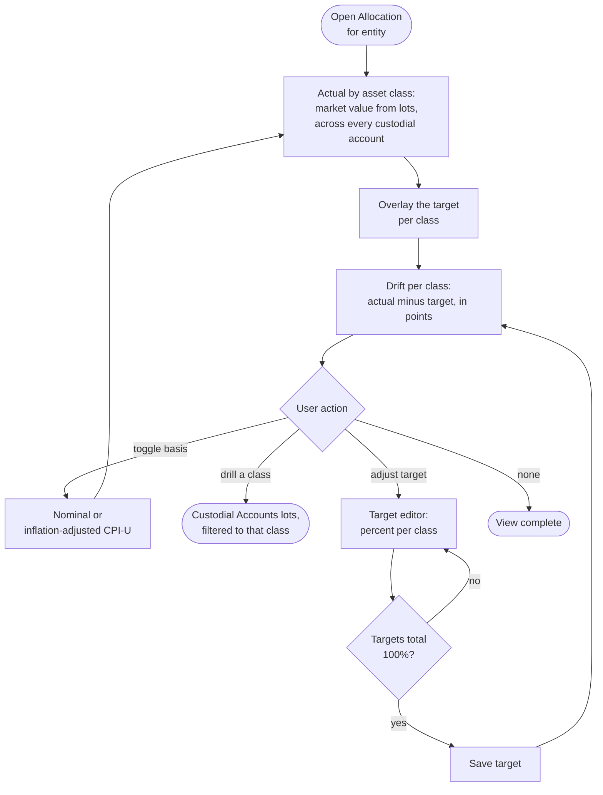

# Flow: Allocation vs. target

**Stories (PRD §4.8, §4.10):** an asset-allocation view with target adjustments, so actual holdings compare to where I want them; values readable in nominal or inflation-adjusted (CPI-U) terms.

**Notes**
- **Same data, different aggregation:** actual allocation is the lots' market value summed by asset class across every custodial account for the entity — not a new data source.
- **Drift is information, not a warning.** Over or under target shows as a neutral `outline` badge ("+2 pt over", "−2 pt under"); on target shows the positive soft badge. No caution or danger hue.
- **Drill:** each asset-class name opens Custodial Accounts' lots, filtered to that class, so every percentage traces to the lots behind it.
- **Target editor:** Save is enabled only when the targets total 100%. Viewers see the chart but no editor and no Save (write controls are omitted, not greyed).
- **Nominal / CPI-U toggle** (PRD §4.10) is orthogonal to actual-vs-target: it restates dollar figures and the over-time view in real terms; the percentage split itself does not change with the basis.
