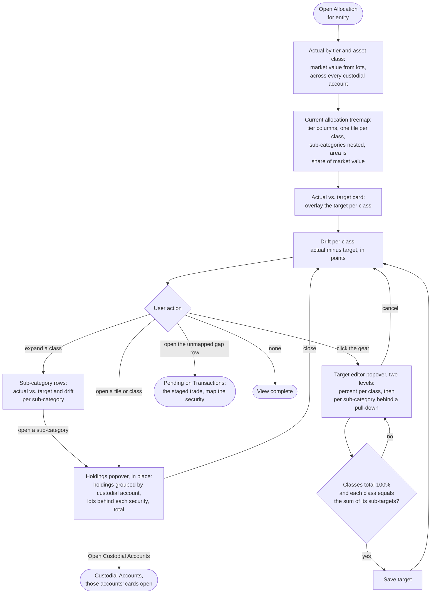

# Flow: Allocation vs. target

**Story (PRD §4.8):** an asset-allocation view with target adjustments, so actual holdings compare to where I want them.

**Notes**
- **Same data, different aggregation:** the four classes are the ledger's nature classes. The market reading (lots by class, plus cash) ties to Custodial Accounts' market value; the book reading (the nature accounts) ties to its book value and the General Ledger tree.
- **Classes fixed, sub-categories yours.** The target editor cannot add or remove a class, because the ledger is organised by them. Sub-categories are a per-security mapping outside the ledger and stay editable.
- **Unmapped holdings are a visible gap,** never silently excluded: a position the custodian reports with no class mapping shows as a gap row with its dollars and a route to the staged trade in Pending, outside the total until mapped.
- **Drift is information, not a warning.** Over or under target shows as a neutral `outline` badge ("+2 pt over", "−2 pt under"); on target shows the positive soft badge. No caution or danger hue.
- **Tier, class, sub-category.** Asset classes sit under two tiers: Current (Cash and cash equivalents) and Non-Current (Fixed income securities, Marketable securities, Alternative investment assets). A tier is a label with its share, never a colour: captions over the treemap's two columns, group headers in the bars and the target editor.
- **Treemap first, table second.** The page opens on the current allocation as a nested treemap: one tile per asset class in its fixed categorical slot, its sub-categories inside it in the same slot. The Actual vs. target card below is its table view and carries every percent.
- **Drill opens in place.** Each treemap tile and each asset-class or sub-category name opens a read-only holdings popover on Allocation, because a class spans accounts and no single Custodial card can show it. Header: name, tier path, actual percent and dollars, target, drift badge. Body: the holdings behind that figure, grouped by custodial account with the account's share, each security with the Custodial card's lots pull-down; a cash sub-category lists cash balances per account. Footer: the aggregate total and one link, Open Custodial Accounts, which arrives with those accounts' cards open. Esc or a click outside closes it.
- **Sub-categories behind a pull-down.** Every class row, in the Actual vs. target card and in the target editor, has a chevron that reveals its sub-categories (the lots sub-card's disclosure pattern). Seeded defaults: Cash and cash equivalents → Cash, Money market; Fixed income securities → Treasuries, Corporate, Municipal; Marketable securities → US Large cap, US Mid/Small cap, Intl Developed, Intl Emerging; Alternative investment assets → Digital Assets. Money market reads the provider's reported position; the rest of the cash is Cash; a manual or file custodial account shows all its cash as Cash. In the Actual vs. target card, each sub-row shows its own actual / target and drift badge.
- **The gear opens the target editor.** A gear icon button at the top right of the Actual vs. target card opens the editor in a popover anchored to it, non-modal so the bars stay readable while targets change. Cancel or Esc closes it and discards the edits; a click outside closes it only when nothing has been edited. Focus moves to the first input on open and returns to the gear on close.
- **Target editor, two levels:** sub-targets are whole-portfolio percent and must sum to their class target; the class row stays editable and carries a reconcile badge (positive soft "Sub-targets sum to N%", or neutral outline "N pt unassigned"). Save is enabled only when the classes total 100% and every class reconciles. Viewers see the treemap and the bars but no gear (write controls are omitted, not greyed).
- **No nominal / inflation-adjusted toggle here.** Allocation is a contemporaneous snapshot of today's holdings, so a CPI-U restatement adds no information; the toggle (PRD §4.10) belongs to the time-series views (Dashboard net-worth chart, Reports).
