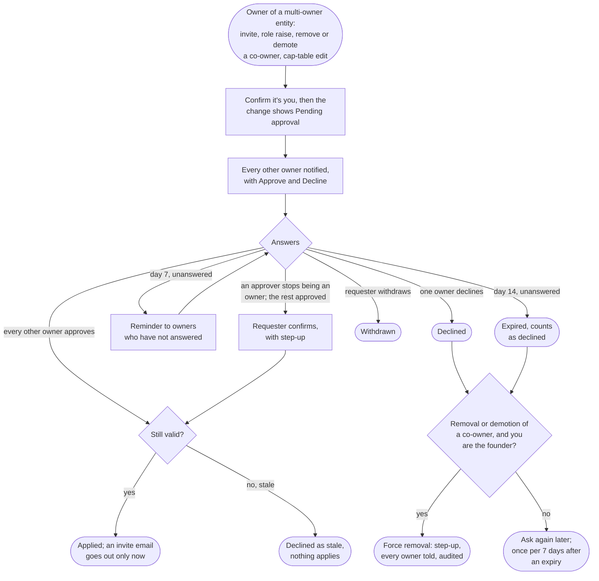

# Flow: Co-owner approval and the founding owner

**Story (PRD §5, access):** As one of several owners of an entity, such as a co-trustee, I want any change to who has access, any owner change and any cap-table edit to wait until every other owner approves, so that no single owner can admit someone or rewrite ownership alone.

**Notes**
- **What waits.** On an entity with more than one owner: inviting a member or raising a role; removing or demoting a co-owner; any cap-table edit, including a former holder's label. Removing a viewer or manager, and lowering or giving up one's own role, act at once. A sole owner acts alone, including adding the first co-owner.
- **The invite screen says so.** On a multi-owner entity the invite dialog's subtitle reads "The Moskos has two owners, so the invite is sent after Sam Mosko approves.", its button reads **Request invite**, and it states the 14-day window. On a sole-owner entity the subtitle is gone and the button reads **Send invite**. The invitee hears nothing until the request applies.
- **Pending is visible where the change will land.** A requested invite is a row in the members list (email, role, outline `Pending approval` badge with a clock, "Invite requested by you · awaiting Sam Mosko · expires Nov 21"). A requested cap-table change is a dashed line under the table with the proposed split, who it waits on, the expiry and **Withdraw** for the requester; while it is open, **Edit cap table** is omitted, since one request per kind is open at a time. The card's heading carries the count ("2 pending"). Only owners see pending rows, an invitee's email included.
- **Approval requests in Notifications.** "Sam Mosko asks to invite jo@example.com to The Moskos as a manager. The invite is sent once every other owner approves." with **Approve** and **Decline**, and the meta line "requested Nov 7 · expires Nov 21 unless every owner approves". At day 7 owners who have not answered get "Reminder: 7 days left to answer … A request nobody answers expires as declined on Nov 21." Every owner is told the outcome.
- **The target votes.** In a request to remove or demote a co-owner, that co-owner is one of the approvers, so the others cannot remove them alone.
- **The founder breaks the deadlock.** The entity's creator carries an outline `Founder` badge beside Owner. On a declined or expired removal or demotion of a co-owner, and only then, the founder's notice offers **Force removal** (or **Force demotion**). Its confirmation names the person and who declined, says they lose access at once and that every owner, them included, is told and the change is audited, and confirms with the second step; the button is `destructive`. The founder has no other extra power.
- **Transfer founder.** The entity card offers **Transfer founder** to the founder alone, with a kv line "Founding owner: you". Its confirmation picks among the current owners, says the founder stays an owner, and notifies every owner. Stepping down is this action.
- **An approver leaves mid-request.** Their approval stops counting and they stop being required. If the rest have approved, the requester gets "Every remaining owner has approved … Confirm to send the invite." with **Confirm and send** and **Withdraw**; nothing applies on its own.
