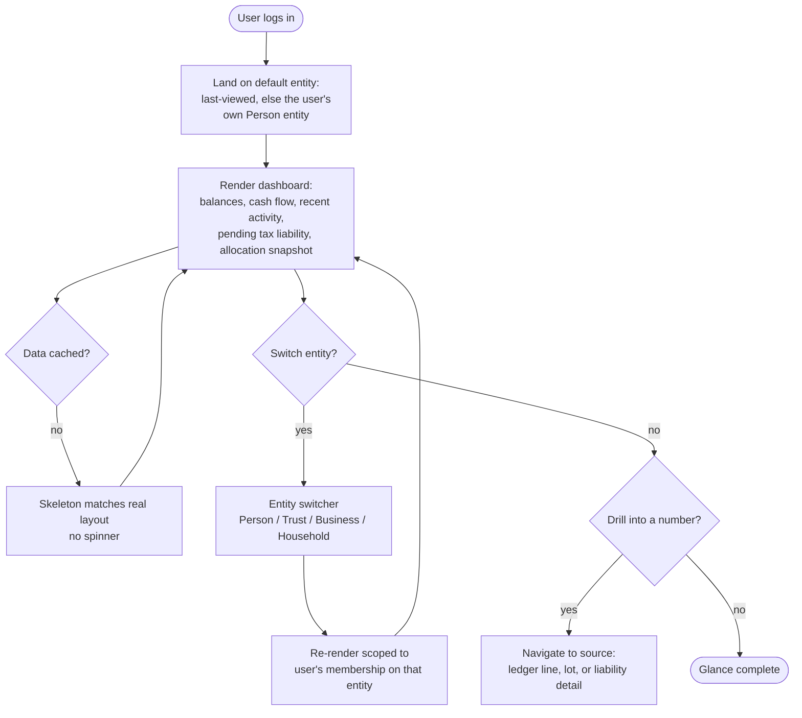

# Flow: Dashboard glance

**Story (PRD §4.2):** As the Principal, I want a dashboard of financial health per entity, so that I can tell at a glance how each entity is doing without opening separate spreadsheets or provider sites.

**Notes**
- Every number on this screen is clickable through to its source (Overview principle: "every number earns trust").
- Filtered strictly by membership (owner / manager / viewer) — no transitive access via a parent entity (PRD §5 permission model).
- Viewer-role household members see the household's shared accounts and their own entity, never another member's entity (PRD §4.9).
- **"Skeleton matches real layout, no spinner":** while dashboard data is loading, the screen shows placeholder blocks already shaped like the real cards (same card chrome, same approximate text-line widths) instead of a spinner, so nothing jumps or re-flows when the real numbers arrive; they fade in where the placeholders were. A spinner says "wait"; a layout-shaped skeleton also says what is coming. See design-system-spec.md § Component inventory → Skeleton.
