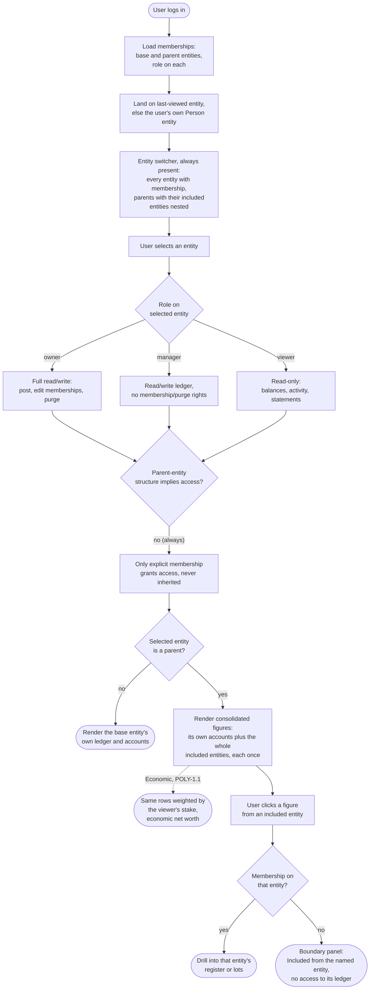

# Flow: Entity switch, roll-up & membership access

**Story (PRD §4.9):** As a household member with a granted viewer role, I want to see the household's shared accounts and my own entity's finances, so that I have visibility into our joint financial picture without owning the underlying ledger.

**Notes**
- **Base and parent entities.** Any entity may hold accounts: a base entity (Person, Trust, Business) has no children, and a parent (Household; Holding) may own accounts directly, such as joint checking. A parent rolls up its own accounts and **whole** entities to any depth, never individual accounts, each entity counted once. An entity may belong to more than one parent.
- **The switcher is always present,** because every user owns at least their own Person entity. It lists every entity the user holds membership on, base and parent, with each parent's included entities nested under it; an entity in two parents is listed under both.
- **Access is explicit membership only** (PRD §5, hard requirement): a parent's membership never grants access to an included base entity, or vice versa.
- **Placement is notify-and-pull-out.** Agreeing to a parent accepts its later placement: every owner beneath is notified, the notification routes to the entity's Included under list, which names the parents above it with direct links marked, and an owner can remove a direct link. Either the entity's owner or the parent's owner may remove it.
- **Tax classification.** A settable field on every entity. A parent is Joint filers or Pass-through to members, the default for a new Household. A pass-through entity allocates tagged income by its cap table on each entry's date; a Joint filers parent ignores its cap table for tax.
- **Cap table beside the membership list.** One list per entity card, two columns, Access (Owner / Manager / Viewer / None) and Units: owner-access members first, then other members, then holders with no access, then the computed Outside owners row and the total. Equity and access never derive from each other. Owners edit, with an effective date on every save and a dated History; every member reads. A no-access Person holder is offered Invite as viewer. The creation form presets 100 units, all the creator's. Refusals: units over the total on a date, an entity becoming its own holder, a chain deeper than one entity.
- **Gross / Economic (POLY-1.1).** A parent view toggles to Economic: every figure weighted by the viewer's stake, closing on economic net worth, over exactly the entities the gross view shows. A 0% entity stays listed.
- **The drill-through boundary.** A parent viewer sees the parent's consolidated figures. Every figure stays clickable; a drill into an included entity the user has no membership on opens a boundary panel — "Included from <entity>. You don't have access to that entity's ledger." — instead of the register, never a disabled number or a silent dead end.
- Role badges (`Owner` / `Manager` / `Viewer`) use decreasing visual weight — `default` / `secondary` / `outline` (design-system-spec.md § Entity, account, and category badges).
- A viewer never sees a write affordance rendered-then-disabled: write controls are omitted entirely for a role that cannot use them.
- **Roll-up map:** Entities opens with a Pack of every entity the user holds membership on — parents as circles nested to any depth, stating any accounts of their own, a shared base entity drawn once in each parent with an "also in" marker; each circle switches entity. The membership list below it is the accessible fallback. See design-system-spec.md § Entities & membership.
