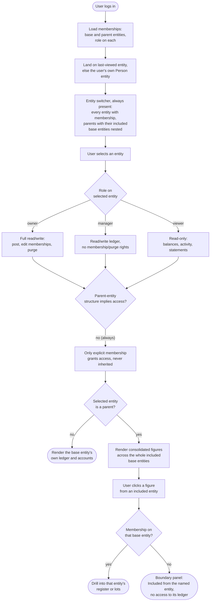

# Flow: Entity switch, roll-up & membership access

**Story (PRD §4.9):** As a household member with a granted viewer role, I want to see the household's shared accounts and my own entity's finances, so that I have visibility into our joint financial picture without owning the underlying ledger.

**Notes**
- **Base and parent entities.** Accounts (custodial and GL) live only in base entities: Person, Trust, Business. A parent (Household; Holding) rolls up **whole** base entities, never individual accounts. A base entity may belong to more than one parent.
- **The switcher is always present,** because every user owns at least their own Person entity. It lists every entity the user holds membership on, base and parent, with each parent's included base entities nested under it; a base entity in two parents is listed under both.
- **Access is explicit membership only** (PRD §5, hard requirement): a parent's membership never grants access to an included base entity, or vice versa.
- **The drill-through boundary.** A parent viewer sees the parent's consolidated figures. Every figure stays clickable; a drill into an included base entity the user has no membership on opens a boundary panel — "Included from <entity>. You don't have access to that entity's ledger." — instead of the register, never a disabled number or a silent dead end.
- Role badges (`Owner` / `Manager` / `Viewer`) use decreasing visual weight — `default` / `secondary` / `outline` (design-system-spec.md § Entity, account, and category badges).
- A viewer never sees a write affordance rendered-then-disabled: write controls are omitted entirely for a role that cannot use them.
- **Roll-up map:** Entities opens with a Pack of every entity the user holds membership on — parents as circles holding their base entities, a shared base entity drawn once in each parent with an "also in" marker; each circle switches entity. The membership list below it is the accessible fallback. See design-system-spec.md § Entities & membership.
