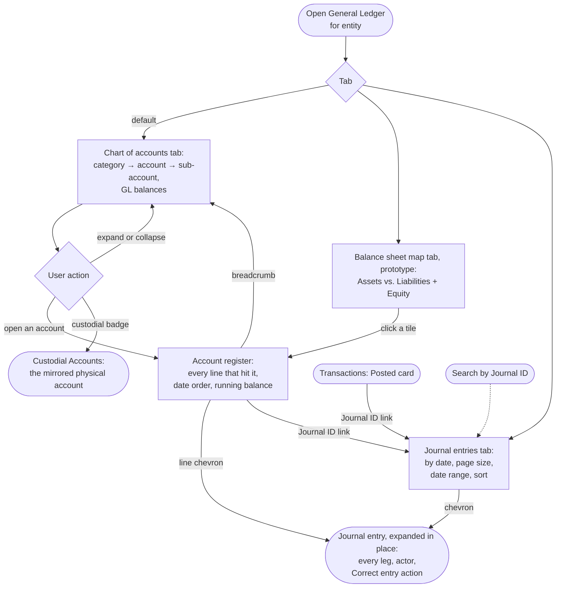

# Flow: General Ledger — tree, register, entry

**Story (PRD §4.7):** a balance sheet by GL account, every figure traceable to the entries behind it.

**Notes**
- **Three tabs, one section at a time:** Chart of accounts (the default), Balance sheet map and Journal entries, in one `Tabs` row at the top of the content. Each keeps its card header. The URL hash carries the tab, so Back from a register returns to the tab it left; a Journal ID link selects Journal entries; the register's breadcrumb returns to the tree.
- **The tree is the GL's own view:** every balance is the ledger's figure. The custodial badge (`landmark` icon + institution) is a cross-reference to Custodial Accounts, never a second data source; accounts with no physical counterpart (Owner's Equity, Cash in Transit) carry none.
- **The register is account-scoped and running-balance-shaped;** Transactions is entry-scoped and time-ordered across every account. Different questions, deliberately two screens.
- **A register line expands to its full journal entry** in the same block as the Journal entries card: every leg, not just the one that hit this account, plus the correction trail where one exists, with actor attribution and the Correct entry action (flow 5.3). Its Journal ID links to the GL card.
- **Balance sheet map (prototype):** a nested treemap on its own tab, Assets | Liabilities + Equity as equal halves; each tile opens its register. Recommendation and limits: design-system-spec.md § General Ledger → Treemap prototype.
- **Journal entries card:** on its own tab, every posted entry header for the entity, newest first, with page size, date range (default This month, by ruling) and sort. A chevron opens the legs in the same block as Transactions' Posted card. It lists a correction's three entries as three rows; the Posted card rolls them into one.
- **Journal ID:** a short per-entity display number, `JE-000214`, assigned at posting and distinct from the UUID key: gapless, serialized per entity, never reused. It leads the Journal entries card, the Posted card and the register, copied on hover, so any entry can be cited exactly.
- **Journal ID links:** on the register and the Posted card the ID links to the entry's row on the Journal entries card (`general-ledger.html#je-000212`), which selects the tab, highlights the row and opens its legs, widening the date range if needed. An exact ID in search resolves to the same row within the active entity; no search surface is drawn yet (design-system-spec.md § Header).
- **Reversed entries stay listed, muted:** no filter hides them. A Reversed original and its reversal render in muted ink, the original's description struck through; the Journal ID keeps full ink because it is the reference.
