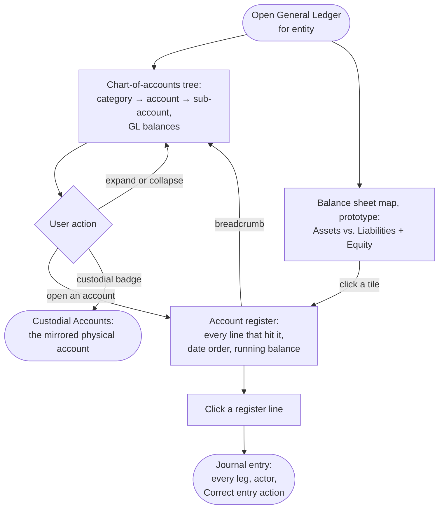

# Flow: General Ledger — tree, register, entry

**Story (PRD §4.7):** a balance sheet by GL account, every figure traceable to the entries behind it.

**Notes**
- **The tree is the GL's own view:** every balance is the ledger's figure. The custodial badge (`landmark` icon + institution) is a cross-reference to Custodial Accounts, never a second data source; accounts with no physical counterpart (Owner's Equity, Cash in Transit) carry none.
- **The register is account-scoped and running-balance-shaped;** Transactions is entry-scoped and time-ordered across every account. Different questions, deliberately two screens.
- **A register line opens its full journal entry** — every leg, not just the one that hit this account — with actor attribution and the Correct entry action (flow 5.3).
- **Balance sheet map (prototype):** a nested treemap card above the tree, Assets | Liabilities + Equity as equal halves; each tile opens its register. Recommendation and limits: design-system-spec.md § General Ledger → Treemap prototype.
