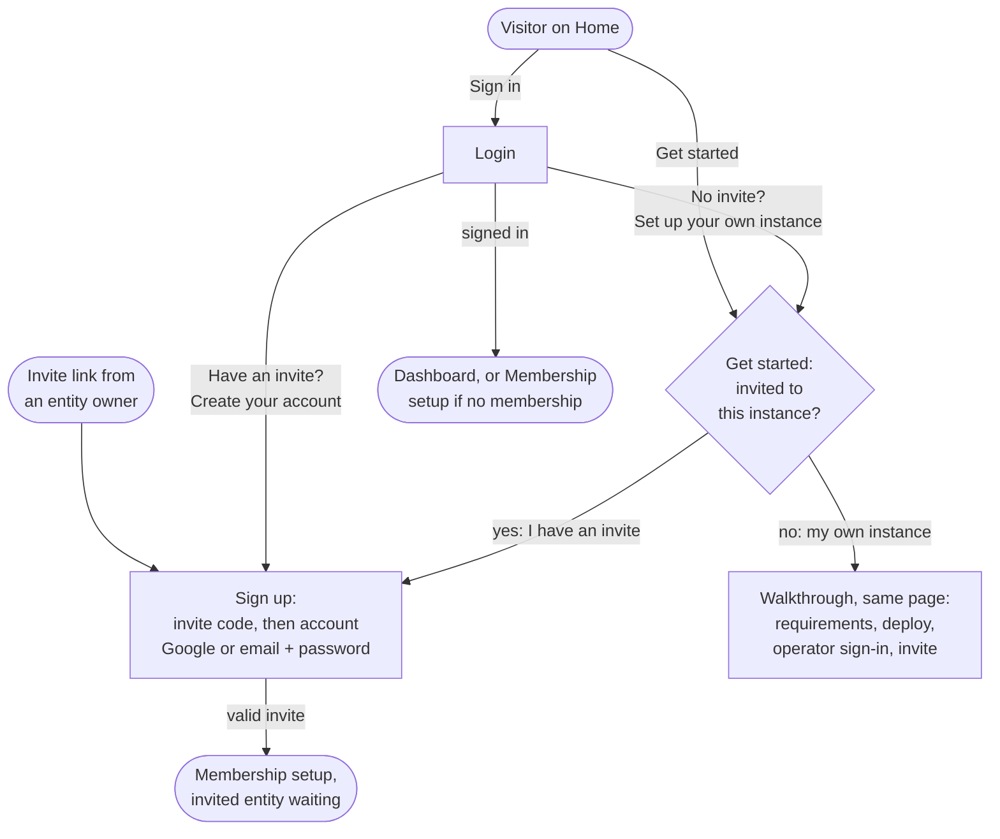

# Flow: Home entry — Sign in, Get started, Sign up

**Story:** As a visitor arriving at a Polycarpic instance's Home page, I want the two buttons in its top bar to take me somewhere that fits my situation — signing in to an account I have, joining an instance I was invited to, or setting up an instance of my own — so that I never hit a public sign-up form that a self-hosted product cannot honour.

**Notes**
- **There is no public sign-up.** Every instance is self-hosted and accounts on it come by invitation from an entity owner. The bar's action is therefore "Get started", never "Sign up".
- **Get started is one page, not a modal.** The fork sits on top as two cards. The walkthrough sections sit directly below, so a self-hosting visitor never leaves the page, and the walkthrough has room to grow as the deployment docs are written. *Alternative:* a modal opened from the bar's Get started button, holding just the two fork cards. It is lighter on Home, but the walkthrough then needs a page of its own anyway.
- **Login shows the same branch.** In place of a generic "Sign up" link, its account line reads "Have an invite? **Create your account**" (to Sign up) and "No invite? **Set up your own instance**" (to Get started).
- **Sign up is invite-gated.** The visitor arrives from an invite link, with the code pre-filled and validated, or types the code. A valid invite names who invited them and to which entity. The account form (Google, or email + password) only creates the account; Membership setup is where the invited entity is waiting.
- An invalid or used code keeps the visitor on Sign up with an inline error under the field; it never sends them to a dead end.
