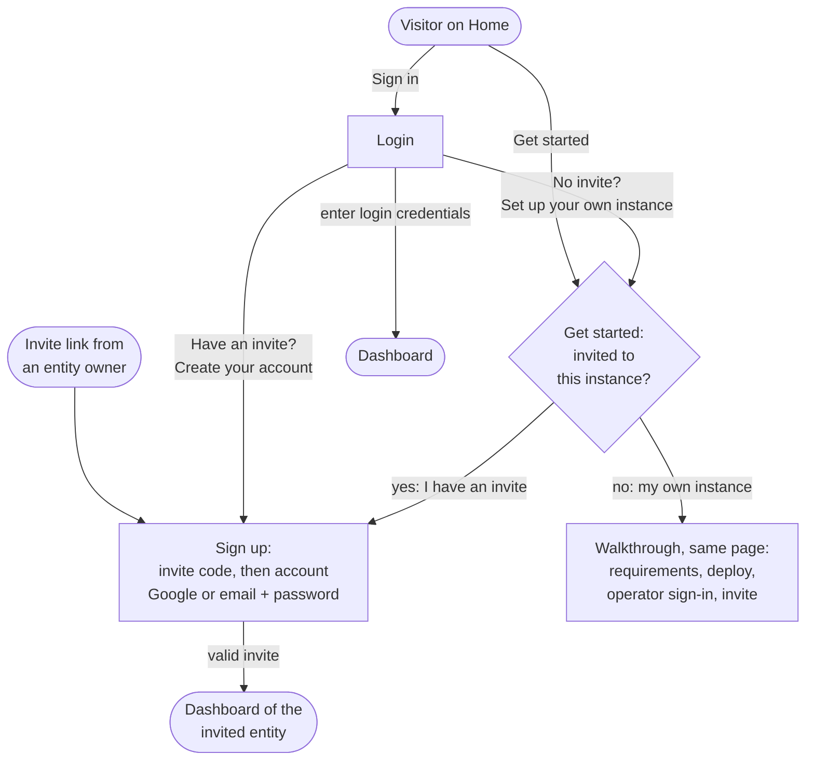

# Flow: Home entry — Sign in, Get started, Sign up

**Story (PRD §4.1):** As a visitor arriving at a Polycarpic instance's Home page, I want the two buttons in its top bar to take me somewhere that fits my situation — signing in to an account I have, joining an instance I was invited to, or setting up an instance of my own — so that I never hit a public sign-up form that a self-hosted product cannot honour.

**Notes**
- **No public sign-up.** Every instance is self-hosted and accounts on it come by invitation from an entity owner. The bar's action is therefore "Get started", never "Sign up".
- **Get started is one page, not a modal.** The fork sits on top as two cards ("I have an invite" → Sign up; "I'm setting up my own instance" → the walkthrough directly below), so a self-hosting visitor never leaves the page and the walkthrough has room to grow. *Alternative:* a modal from Home's Get started button holding just the two cards; lighter on Home, but the walkthrough then needs its own page anyway.
- **Login shows the same branch.** Its account line reads "Have an invite? **Create your account**" (to Sign up) and "No invite? **Set up your own instance**" (to Get started).
- **Every sign-in lands on a dashboard.** Account creation also creates the user's own Person entity, so there is no signed-in state without an entity (design-system-spec.md § Entities & membership). Login lands on the last-viewed entity, else that Person entity; the operator's first sign-in after setup lands on the operator's own Person entity.
- **Sign up is invite-gated.** The code arrives pre-filled and validated from an invite link, or is typed. A valid invite names the inviter and the entity. The invite is common to both account paths (Google, or email + password), and creating the account lands on the dashboard of the invited entity.
- An invalid or used code keeps the visitor on Sign up with an inline error under the field; it never sends them to a dead end.
