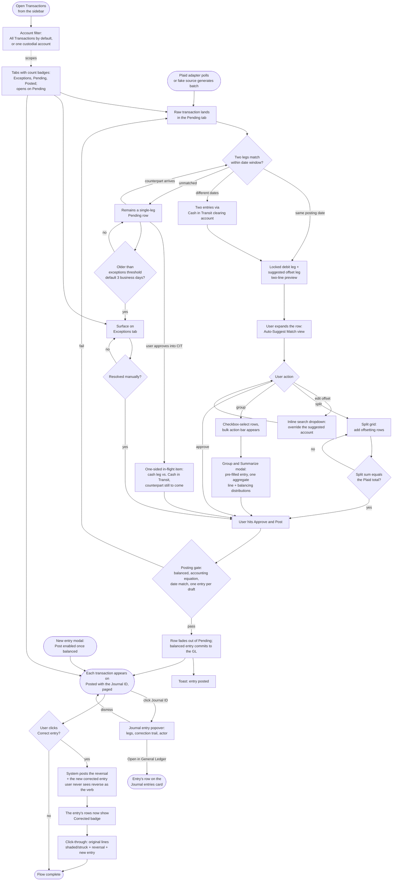

# Flow: Transactions — review, match & correct

**Story (PRD §4.3):** As the Principal, I want my bank and brokerage transactions imported automatically and staged for review, so that I can review and confirm them instead of hand-entering every transaction.

**Notes**
- **Account filter.** A selector at the right end of the tab row scopes Exceptions, Pending and Posted together, count badges included. Opening Transactions from the sidebar always lands on **All Transactions** (every custodial account in the entity); the popover lists each custodial account by the name Custodial Accounts uses, with its provider and open-item counts. The Known delta badge on a Custodial Accounts card deep-links here with the filter preset to that account. On Posted the rule is the same for every row: a row matches a selected account when its entry has a leg on that custodial account. All Transactions shows everything, including an entry with no custodial leg, such as an accrual, which no single account's view lists.
- **Tabs with count badges.** Exceptions, Pending and Posted are one `Tabs` row, left of the account filter, one visible at a time, in urgency order. Each tab carries its count, so every stage's load stays visible while another is open: `secondary`, `destructive-soft` on Exceptions when non-zero. Transactions opens on Pending, the review inbox; a non-zero Exceptions count does not take the default, its badge is red instead. The counts follow the account filter, changing the filter keeps the current tab, and the URL hash carries the tab.
- **Every row names its source.** Each Exceptions, Pending and Posted row carries one muted line under the payee: `landmark` icon + `<account> · <institution> via <provider>` (e.g. "Primary Checking · Bank Y via Plaid"). A manual entry has no bank source, so its line reads `pen-line` icon + "Manual entry". With the filter on one account, a line that only repeats the trigger is omitted; a Manual entry line and the counterpart row of a transfer keep theirs.
- **The locked leg is always the custodial cash side** — verified bank reality (the Plaid transaction itself), never editable, in the two-line preview, the Split grid, or the Group modal. **The suggested offset leg** is pre-filled from historical rules + the Plaid category and overridden in place via an inline search dropdown, never a blank field.
- **Split** is one draft → one multi-leg entry, live-validated: submission stays disabled until the rows sum exactly to the raw transaction's absolute total. **Group** is many drafts → one entry (ARCH §3), the same many-to-one shape as a same-date matched transfer, via the shared journal-entry modal, pre-filled with one aggregate line + balancing distributions.
- **Posted is transaction-scoped.** Every posted transaction is a row, mirroring Pending, and carries its entry's Journal ID. An entry built from several transactions appears as several rows with one ID: a group, or a same-date matched transfer (two legs, one entry). The rows sit together, because an entry has one date and same-date rows order by Journal ID. A split stays one row, however many legs its entry has. A transfer whose legs land on different dates posts as two entries through Cash in Transit, so its two rows carry two IDs. With the filter on one account, both rows of a same-date transfer show, because their one entry has a leg on it; a different-date transfer shows only that account's row. The Posted badge counts rows, so it differs from the entry count on the GL Journal entries card, which is the entry-grained view.
- **A manual entry is a Posted row like any other.** An entry from the New entry modal is one row with its own Journal ID, however many legs it has. It cannot exist outside a compliant journal entry, so the same rules apply: the account filter, Correct entry, the Journal ID popover. Its Amount is the entry's sum of debits, unsigned, because it has no bank sign.
- **Journal ID popover.** Clicking a Journal ID on Posted opens a `Popover` anchored to the ID, so an entry can be read without leaving the list. Header line: Journal ID with copy, posting date, actor, status badge. Body: every leg, then the correction trail if any (the original and its reversal, since the entry's own legs are already above). Footer: **Open in General Ledger**, to the entry's row on the Journal entries card. It is non-modal: an outside click or Esc dismisses it and focus returns to the ID. The View correction chevron on a Corrected row is a separate control: it expands the trail in place. The account register's Journal ID stays a link to the GL.
- **An unmatched transfer leg stays a staged draft** in Pending until its counterpart arrives (then it matches like any transfer), or until the user explicitly approves it into Cash in Transit as a one-sided in-flight item — a balanced entry, cash leg against the CIT clearing account, cleared when the counterpart posts. A draft still unmatched past the exceptions threshold moves to Exceptions.
- **Posting gate:** Σ debits = Σ credits; the accounting equation holds per entity; the entry date matches the bank date (or the Cash-in-Transit rule); every posted draft links to exactly one entry, and several drafts may share it (a group, a same-date matched transfer). Any failure keeps the item in Pending — no partial or silent post.
- A posted row's user-facing action is **"Correct entry"**, never "edit" or "reverse" — reversal-only underneath (PRD §5). Click-through shows the full trail: original lines shaded/struck, the reversal, and the new entry. Correct entry on any row of a multi-row entry corrects that one entry, and every row of it then carries the corrected entry's ID and the Corrected badge. See design-system-spec.md § Correcting a posted entry.
- Badges: `Draft (staged)` (`--secondary`, clock), `Posted` (`--outline`, check), `Corrected` (`--outline` + `--brand-2`-tinted dot, pencil). An auto-posted row carries `Posted` plus a `posted by rule — <name>` line and the same Correct entry action.
- Actor attribution (user / auto-post rule / system job) is shown on every draft and posted row, never inferred (PRD §5).
- Import stats and link status (provider sync time, link health) show as a banner at the top of Transactions, not as a separate nav item.
