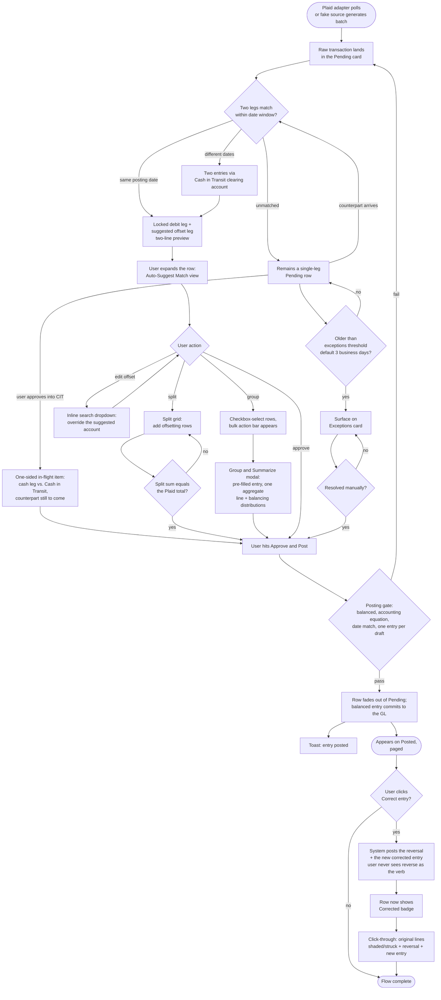

# Flow: Transactions — review, match & correct

**Story (PRD §4.3):** As the Principal, I want my bank and brokerage transactions imported automatically and staged for review, so that I can review and confirm them instead of hand-entering every transaction.

**Notes**
- **The locked leg is always the custodial cash side** — verified bank reality (the Plaid transaction itself), never editable, in the two-line preview, the Split grid, or the Group modal. **The suggested offset leg** is pre-filled from historical rules + the Plaid category and overridden in place via an inline search dropdown, never a blank field.
- **Split** is one draft → one multi-leg entry, live-validated: submission stays disabled until the rows sum exactly to the raw transaction's absolute total. **Group** is many drafts → one entry (the one many-to-one case, ARCH §3) via the shared journal-entry modal, pre-filled with one aggregate line + balancing distributions.
- **An unmatched transfer leg stays a staged draft** in Pending until its counterpart arrives (then it matches like any transfer), or until the user explicitly approves it into Cash in Transit as a one-sided in-flight item — a balanced entry, cash leg against the CIT clearing account, cleared when the counterpart posts. A draft still unmatched past the exceptions threshold moves to Exceptions.
- **Posting gate:** Σ debits = Σ credits; the accounting equation holds per entity; the entry date matches the bank date (or the Cash-in-Transit rule); every posted draft links to exactly one entry. Any failure keeps the item in Pending — no partial or silent post.
- A posted row's user-facing action is **"Correct entry"**, never "edit" or "reverse" — reversal-only underneath (PRD §5). Click-through shows the full trail: original lines shaded/struck, the reversal, and the new entry. See design-system-spec.md § Correcting a posted entry.
- Badges: `Draft (staged)` (`--secondary`, clock), `Posted` (`--outline`, check), `Corrected` (`--outline` + `--brand-2`-tinted dot, pencil). An auto-posted row carries `Posted` plus a `posted by rule — <name>` line and the same Correct entry action.
- Actor attribution (user / auto-post rule / system job) is shown on every draft and posted row, never inferred (PRD §5).
- Import stats and link status (provider sync time, link health) show as a banner at the top of Transactions, not as a separate nav item.
