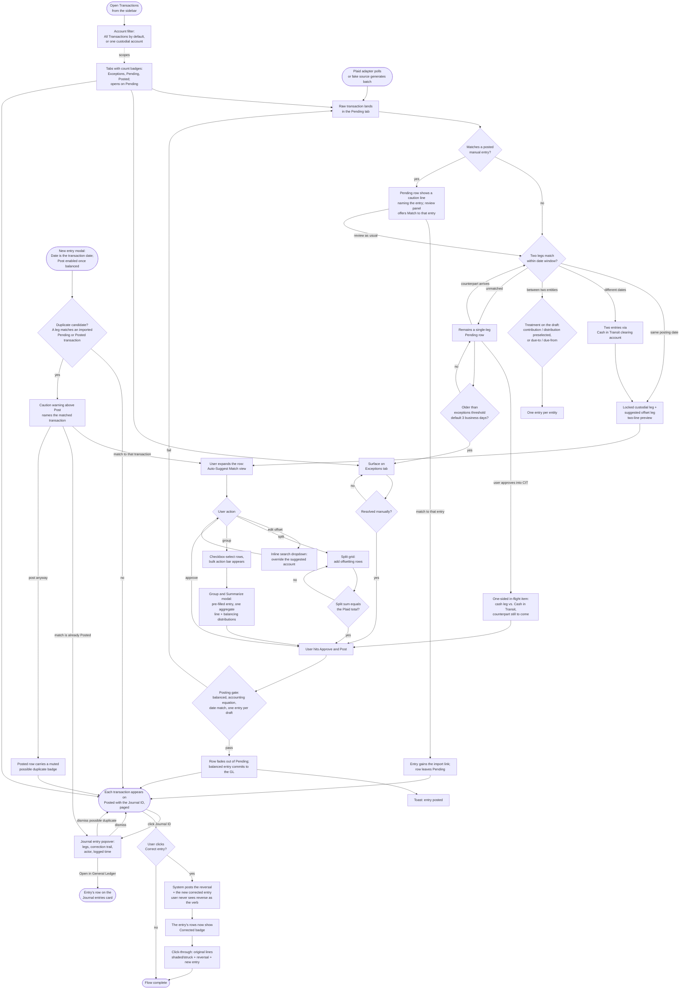

# Flow: Transactions — review, match & correct

**Story (PRD §4.3):** As the Principal, I want my bank and brokerage transactions imported automatically and staged for review, so that I can review and confirm them instead of hand-entering every transaction.

**Notes**
- **Account filter.** A selector at the right end of the tab row scopes Exceptions, Pending and Posted together, count badges included. Opening Transactions from the sidebar always lands on **All Transactions** (every custodial account in the entity); the popover lists each custodial account by the name Custodial Accounts uses, with its provider and open-item counts. The Known delta badge on a Custodial Accounts card deep-links here with the filter preset to that account. On Posted the rule is leg-level and the same for every row: with one account selected, only the rows whose own leg posts a debit or credit to that account show, so the counterpart row of a transfer does not appear. A manual entry with a leg on that account shows as one row for that leg. All Transactions shows everything, including a manual entry with no custodial leg, such as an accrual, which no single account's view lists.
- **Tabs with count badges.** Exceptions, Pending and Posted are one `Tabs` row, left of the account filter, one visible at a time, in urgency order. Each tab carries its count, so every stage's load stays visible while another is open: `secondary`, `destructive-soft` on Exceptions when non-zero. Transactions opens on Pending, the review inbox; a non-zero Exceptions count does not take the default, its badge is red instead. The counts follow the account filter, changing the filter keeps the current tab, and the URL hash carries the tab.
- **Every row names its source.** Each Exceptions, Pending and Posted row carries one muted line under the payee: `landmark` icon + `<account> · <institution> via <provider>` (e.g. "Primary Checking · Bank Y via Plaid"). A manual entry has no bank source, so its line reads `pen-line` icon + "Manual entry". With the filter on one account, a line that only repeats the trigger is omitted; a Manual entry line stays.
- **The locked leg is always the custodial cash side,** debit on inflows, credit on outflows — verified bank reality (the Plaid transaction itself), never editable, in the two-line preview, the Split grid, or the Group modal. **The suggested offset leg** is pre-filled from historical rules + the Plaid category and overridden in place via an inline search dropdown, never a blank field.
- **A leg always names its account by full path,** root to leaf, in the Pending preview, the Split grid, the New entry modal, and the Posted expansion and popover: Expenses › Office Expense. Account controls show and list paths.
- **Split** is one draft → one multi-leg entry, live-validated: submission stays disabled until the rows sum exactly to the raw transaction's absolute total. **Group** is many drafts → one entry (ARCH §3), the same many-to-one shape as a same-date matched transfer, via the shared journal-entry modal, pre-filled with one aggregate line + balancing distributions.
- **Posted is transaction-scoped.** Every posted transaction is a row, mirroring Pending, and carries its entry's Journal ID. An entry built from several transactions appears as several rows with one ID: a group, or a same-date matched transfer (two legs, one entry). The rows sit together, because an entry has one date and same-date rows order by Journal ID. A split stays one row, however many legs its entry has. A transfer whose legs land on different dates posts as two entries through Cash in Transit, so its two rows carry two IDs. With the filter on one account, only that account's row of a transfer shows, whether the transfer is one entry or two; the Journal ID popover still lists both legs. The Posted badge counts rows, so it differs from the entry count on the GL Journal entries card, which is the entry-grained view.
- **A manual entry is a Posted row like any other.** On All Transactions, an entry from the New entry modal is one row with its own Journal ID, however many legs it has, and its Amount is the entry's sum of debits, unsigned, because it has no bank sign. With one account selected it is one row for the leg on that account, signed like a bank row: a debit to a cash account reads +. It cannot exist outside a compliant journal entry, so the same rules apply: the account filter, Correct entry, the Journal ID popover.
- **Row Date is the transaction date.** Date on Posted and on the GL Journal entries card is the date the user entered on the entry, never the time it was logged. The New entry modal's Date field is that date, so a backdated entry sorts by it on both lists, while its Journal ID still orders by posting. The audit trail (actor, logged-at) lives in the Journal ID popover and the GL entry view, not in the list.
- **Potential-duplicate warning.** While a manual entry is open in the New entry modal, each custodial leg is compared with imported transactions that are Pending or Posted. A candidate has the same custodial account, the same amount and direction, and a date within the entity's Duplicate detection window of the entry's Date, either side (Settings, default ±1 day). A candidate shows a caution-tier warning above the actions naming it: "Looks like Sep 12 · Stripe Payout +$1,500.00 on Primary Checking, Pending". The nearest date is named, and a Pending candidate wins a tie. **Match to that transaction instead** discards the manual entry and opens the Pending row's review panel, pre-filled with the modal's offset leg; for a Posted candidate this action reads **Open that entry** and opens its Journal ID popover. **Post anyway** takes the Post button's place and posts the entry: its row carries a muted `outline` `possible duplicate` badge under its status until the user dismisses it from the popover or matches the import. Only New entry and imports check, because Correct entry, Split and Group start from a real transaction.
- **Mirror on Pending.** The same rule and window run on Pending: an imported transaction that matches a posted manual entry, whichever arrived first, shows a caution line on its row: "Looks like manual entry JE-000215 · Sep 11 · +$1,500.00". The line shows collapsed or expanded, and the Journal ID opens that entry's popover. The nearest date is named, and an entry already linked to an import is no longer a candidate. The review panel adds **Match to that entry** as its default action, and Approve & Post steps down to an outline button beside it so Enter cannot slip past it. **Match to that entry** links the import to the existing entry and posts nothing: the row leaves Pending, the entry stays as it is, and the Posted count holds. The entry's row gains a `matched import` status line and loses any `possible duplicate` badge, and its popover lists the import. Approve & Post past the caution keeps both. Dismiss possible duplicate on the entry clears the caution on the row it names.
- **Journal ID popover.** Clicking a Journal ID on Posted opens a `Popover` anchored to the ID, so an entry can be read without leaving the list. Header line: Journal ID with copy, transaction date, actor, "logged <timestamp>", status badge. Body: every leg, then the correction trail if any (the original and its reversal, since the entry's own legs are already above). Footer: **Open in General Ledger**, to the entry's row on the Journal entries card, plus **Dismiss possible duplicate** on a row that carries that badge. It is non-modal: an outside click or Esc dismisses it and focus returns to the ID. The View correction chevron on a Corrected row is a separate control: it expands the trail in place. The account register's Journal ID stays a link to the GL.
- **A cross-entity transfer carries one treatment choice** on the draft: contribution / distribution preselected, or due-to / due-from. Each option says in plain language what it does to both balance sheets, and due-to / due-from says repayment is expected. One entry posts per entity, and both need Manager.
- **A brokerage draft splits by nature,** one line per security under its nature account, with the cash leg locked. A trade in an unmapped security stays in Pending with an inline Map security form; mapping clears every waiting trade in it and Allocation's gap.
- **An unmatched transfer leg stays a staged draft** in Pending until its counterpart arrives (then it matches like any transfer), or until the user explicitly approves it into Cash in Transit as a one-sided in-flight item — a balanced entry, cash leg against the CIT clearing account, cleared when the counterpart posts. A draft still unmatched past the exceptions threshold moves to Exceptions.
- **Posting gate:** Σ debits = Σ credits; the accounting equation holds per entity; the entry date matches the bank date (or the Cash-in-Transit rule); every posted draft links to exactly one entry, and several drafts may share it (a group, a same-date matched transfer). Any failure keeps the item in Pending — no partial or silent post.
- A posted row's user-facing action is **"Correct entry"**, never "edit" or "reverse" — reversal-only underneath (PRD §5). Click-through shows the full trail: original lines shaded/struck, the reversal, and the new entry. Correct entry on any row of a multi-row entry corrects that one entry, and every row of it then carries the corrected entry's ID and the Corrected badge. See design-system-spec.md § Correcting a posted entry.
- Badges: `Draft (staged)` (`--secondary`, clock), `Posted` (`--outline`, check), `Corrected` (`--outline` + `--brand-2`-tinted dot, pencil). An auto-posted row carries `Posted` plus a `posted by rule — <name>` line and the same Correct entry action. `possible duplicate` (`--outline`, muted ink) sits under the status of a manual row posted past the duplicate warning; `matched import` is the status line of a manual row linked to its import.
- Actor attribution (user / auto-post rule / system job) is shown on every draft and posted row, never inferred (PRD §5).
- Import stats and link status (provider sync time, link health) show as a banner at the top of Transactions, not as a separate nav item.
