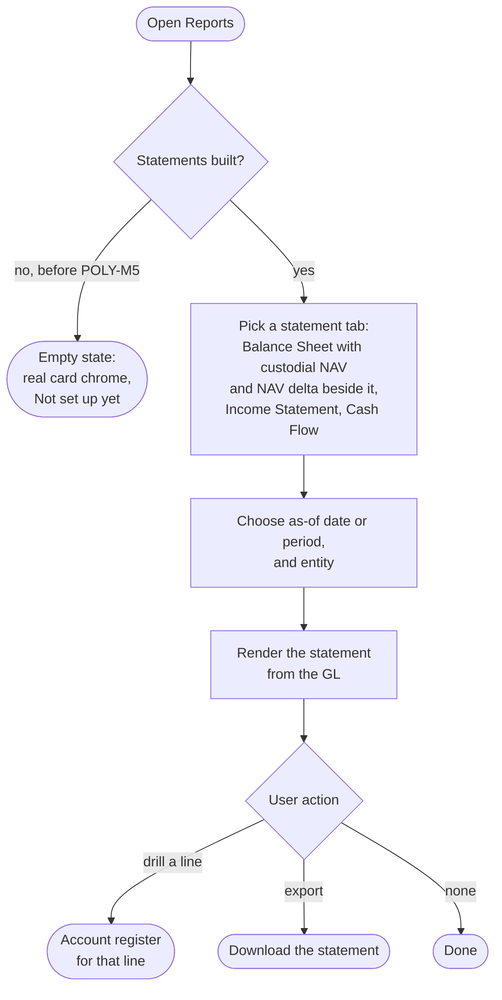

# Flow: Reports

**Stories (PRD §4.6–4.7):** financial statements per entity — Balance Sheet, Income Statement, Cash Flow — with custodial NAV and NAV delta, each line traceable to its register and exportable.

**Notes**
- **A nav item from day one.** Until POLY-M5 ships statements, every tab shows the Dashboard's empty-state pattern: real card chrome and plain "Not set up yet" copy that never names a milestone or version. The tab is never hidden or disabled.
- **Custodial NAV and NAV delta** (ARCH §2.4) sit beside the Balance Sheet, not as extra tabs.
- **Estimated tax since last close.** Between closes the Balance Sheet and NAV add one computed line, labelled as an estimate and kept out of the trial balance, with "last closed through" under the statement. Net assets are right on any day with nothing posted on read.
- The as-of date (Balance Sheet) or period (Income Statement, Cash Flow) and the entity scope every figure; the entity comes from the header selector.
- Every statement line drills to the account register behind it (flow 5.8). Export formats are not yet specified.
- `reports.html` shows dimmed Balance Sheet, Income Statement and Cash Flow previews for review only; they do not ship.
