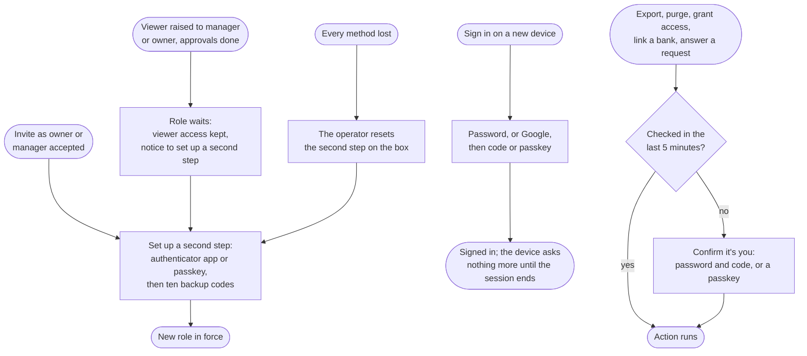

# Flow: Second step and step-up

**Story (PRD §5, access):** As an owner or manager, I want my sign-in to need more than a password, so that a stolen password alone can never export, purge, link a bank or let someone in; as a viewer, I want the same protection offered but not forced.

**Notes**
- **Required for owners and managers, offered to viewers.** Anyone joining as owner or manager sets up an authenticator app or a passkey on Sign up, before landing (`sign-up.html#second-step`). A viewer sees the same step with **Skip for now**. Signing up or in with Google or Apple exempts no one, because the app cannot see the provider's own second factor.
- **Two methods, then backup codes.** The choice is two radio cards, Authenticator app (a QR code, the key typed out, and a 6-digit check) or Passkey. Ten single-use backup codes follow, shown once.
- **A role raise waits for the second step.** When a viewer without one is raised to manager or owner (after any co-owner approval), the new role does not take effect until they set one up; they keep viewer access meanwhile, and the notice "You are now a manager of <entity>. Set up a second sign-in step to start; until then you keep viewer access." links to Settings → Sign-in and second step. The members list shows their new role with an outline `Waiting for second step` badge.
- **Asked on a new device, not every time.** After the password (or Google), a new device asks for the code, with **Use a passkey instead** and **Use a backup code** below (`login.html#second-step`). A known device asks nothing until its session ends.
- **Step-up before risky actions.** Export, purge, granting access or changing a role, linking or unlinking a bank, answering a co-owner request, forcing a removal, transferring the founder role, deleting the account, and removing a second-step method each open **Confirm it's you** unless the user was checked in the last 5 minutes: password and code, or a passkey. A Google-only user is sent to Google to sign in again, then asked for the code. The dialog names the action ("Exporting Mosko (Person) needs a fresh check") and says it won't ask again for 5 minutes.
- **Settings → Sign-in and second step** lists each method with the date it was added and **Remove**, **Add passkey**, the backup codes left with **Make new codes**, and **Change password**. While the user is an owner or manager anywhere, the last method has no Remove, and the panel says why.
- **Lockout.** "Lost every method? The person who runs this instance can reset your second step." There is no in-app recovery: the operator's audited reset on the box is the path.
