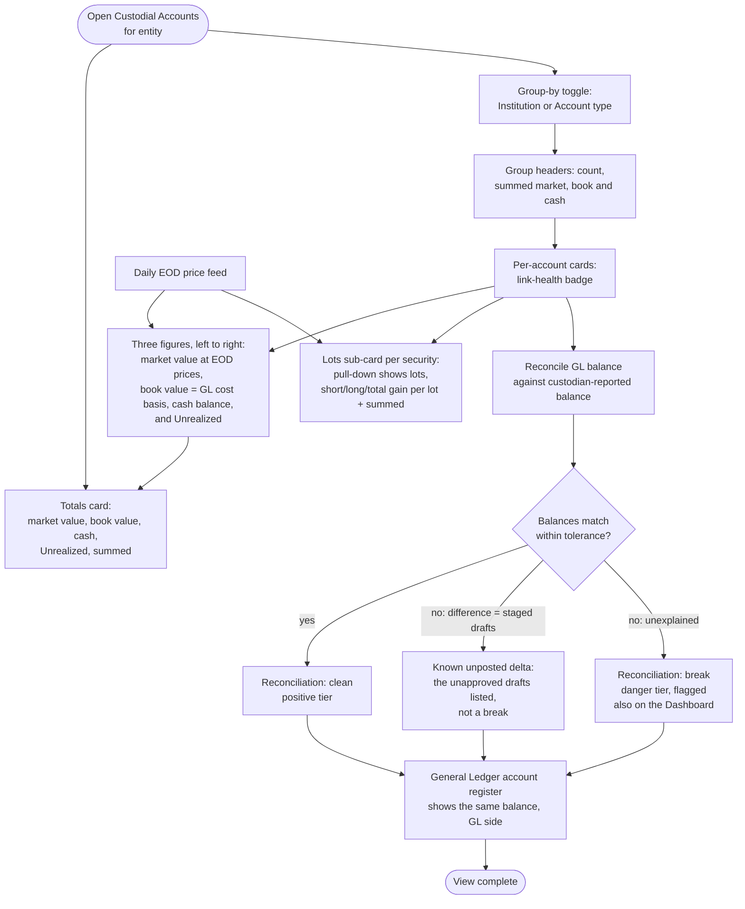

# Flow: Custodial reconciliation & lots

**Stories (PRD §4.6–4.7):** lot-based tracking with GL book value and daily market value; a balance sheet by GL account and a separate one by custodial account, reconciled against each other.

**Notes**
- **Three figures on every account, left to right:** market value (cash plus every position at the last EOD price); book value (the GL's cost basis, cash included — the GL's own balance for the mirrored account); cash balance; and Unrealized = market − book, signed and coloured per § Delta coloring. A cash-only account shows the same row with equal figures and a `$0.00` delta, so cards scan as columns. A totals card sums the four figures across accounts, with the price date. Cash sits last so the row reads as "market and book include cash" — the two totals first, the cash already inside them after.
- **Group by Institution or Account type.** A `Tabs` toggle under the totals card groups the account cards; Institution is the default, and the choice persists per user. A group header carries the account count and the summed market value, book value and cash. The totals card sums asset accounts whichever grouping is on.
- **A credit card is a liability.** Market value and book value both show what is owed, as a negative; cash and Unrealized show a dash. The negative nets into its group, and the totals card states it beside the asset total.
- **The card rests collapsed.** The header carries two badges in a fixed order, link health then reconciliation, because a reconciliation is only as current as the link behind it. A chevron left of the title opens the card's details: the custodian's figure against the GL and the link to any staged drafts, then, on an account that holds securities, the lots sub-card with its pull-down per security. Allocation's holdings popover links here and arrives with the cards of the accounts it lists open.
- An account's Unrealized figure equals its lots sub-card's total unrealized gain; the two must agree.
- **Two nav items:** General Ledger and Custodial Accounts are two separate nav items, not one screen behind a `Tabs` switch. Both read the same lot and journal data; the split is presentation, not a data fork.
- **Unapproved drafts are a known unposted delta, not a break.** When the GL and custodian balances differ by exactly the account's staged drafts (e.g. an unmatched transfer leg not yet approved into Cash in Transit), the card shows the delta and lists those drafts, linking to Pending on Transactions; no danger tier. Only a difference the drafts do not explain is a break.
- A reconciliation break uses the danger tier (`--destructive`) and surfaces on the Dashboard glance too, not only here.
- Allocation (actual vs. target by asset class) is its own flow, 5.6.
