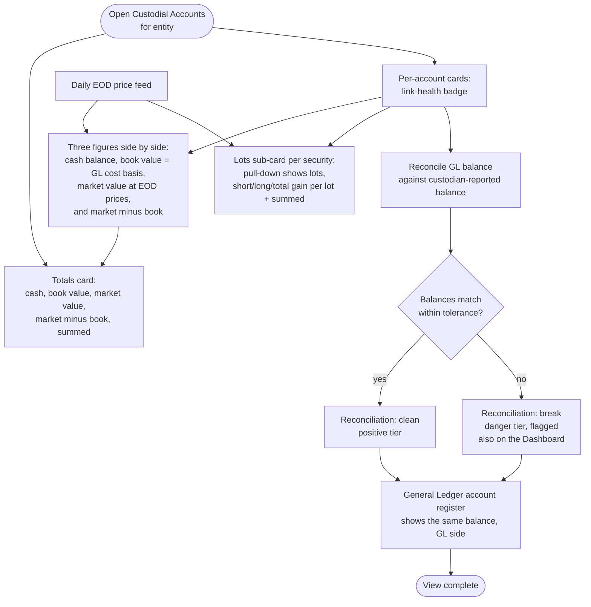

# Flow: Custodial reconciliation & lots

**Stories (PRD §4.6–4.7):** lot-based tracking with GL book value and daily market value; a balance sheet by GL account and a separate one by custodial account, reconciled against each other.

**Notes**
- **Three figures on every account, side by side:** cash balance; book value (the GL's cost basis, cash included — the GL's own balance for the mirrored account); market value (cash plus every position at the last EOD price); and market minus book, signed and coloured per § Delta coloring. A cash-only account shows the same row with equal figures and a `$0.00` delta, so cards scan as columns. A totals card sums the four figures across accounts, with the price date.
- An account's market minus book equals its lots sub-card's total unrealized gain; the two must agree.
- **No toggle:** General Ledger and Custodial Accounts are two separate nav items, not one screen behind a `Tabs` switch. Both read the same lot and journal data; the split is presentation, not a data fork.
- A reconciliation break uses the danger tier (`--destructive`) and surfaces on the Dashboard glance too, not only here.
- Allocation (actual vs. target by asset class) is its own flow, 5.6.
