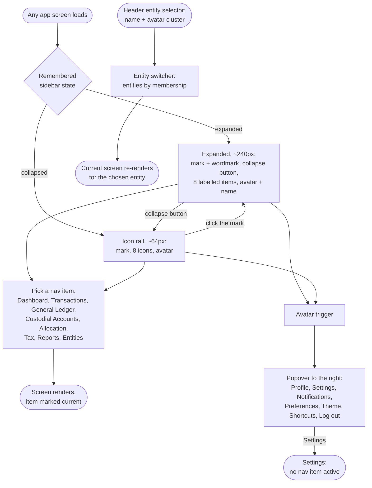

# Flow: Sidebar & app shell

**Story:** As a signed-in user, I want one consistent shell on every app screen — the sidebar, the header's entity selector and my account menu — so that I can move between screens and entities without thinking about where things are.

**Notes**
- **Eight flat items, no nesting** (design-system-spec.md § Sidebar information architecture). Flat is what makes the icon rail work.
- **Collapse to an icon rail.** The cue sits in the brand row: expanded shows a `panel-left-close` button right of the wordmark; collapsed shows the mark alone, which is itself the expand button and swaps to `panel-left-open` on hover or keyboard focus.
- **Remembered state:** the expanded or collapsed choice persists per user across screens and reloads (shadcn `Sidebar`'s stored `open` state).
- **Header entity selector:** the current entity's name and its member avatar cluster (max 3 + "+N"); it opens the entity switcher, and the current screen re-renders for the chosen entity (flow 5.7).
- **Avatar popover** opens to the right of the trigger, in both widths. Settings and Notifications are proposed entry points (`.proposed-tag`); Log out is last, `--destructive`-styled.
- **Keyboard:** Tab order is brand-row button → nav items → avatar trigger; the header follows in the main region. Enter or Space activates; Esc closes the popover and returns focus to its trigger. Every control shows the `--sidebar-ring` focus outline.
