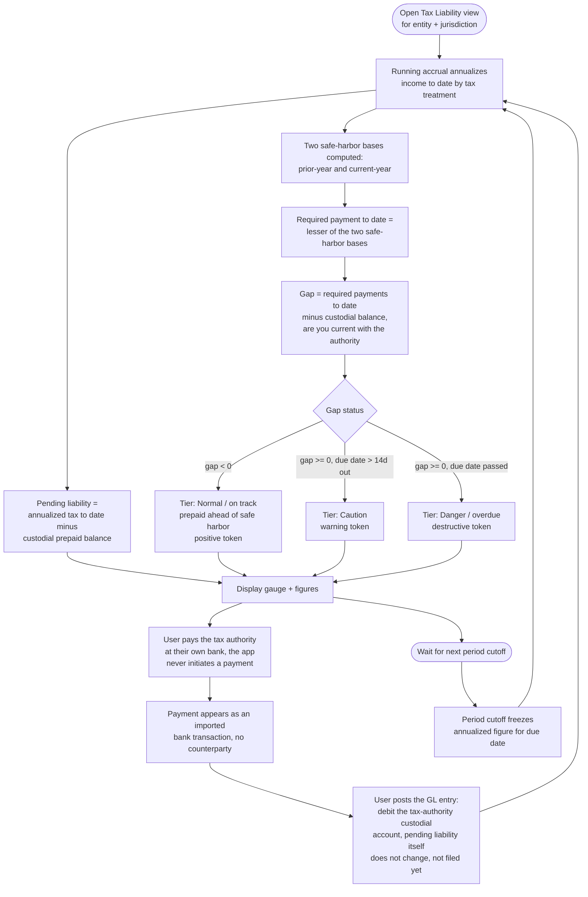

# Flow: Tax liability & safe-harbor

**Story (PRD §4.5):** As the Principal, I want a continuously updated view, per entity and jurisdiction, of my pending tax liability, the required safe-harbor payment, and the gap between them, so that I know exactly how much to wire by each due date.

**Notes**
- **Tiers:** on track when `gap < 0` (prepaid ahead of the safe-harbor requirement); caution when `gap >= 0` and the due date is more than 14 days out; danger when `gap >= 0` and the due date has passed. They reuse the product-wide status vocabulary — design-system-spec.md § Status tiers.
- **Gap = 0 is not on track.** It means exactly at the safe-harbor line, with nothing in hand beyond the requirement, so it takes the caution or danger tier by due date.
- **Two figures,** both measured against the custodial account's balance but not against each other: **Pending liability = annualized tax to date − custodial prepaid balance** (what you would owe net of prepayments, if filed today); **Gap = required payments to date (safe harbor) − custodial balance** ("are you current with the authority"). Gap is never `required − pending`.
- **v1 never moves money.** There is no pay button: the user pays the tax authority at their own bank; the payment lands as an imported transaction with no counterparty; the user posts the GL entry, debiting the custodial tax-authority account (a prepaid-tax asset). Copy says "post your payment" or "record your payment", never "pay" or "transfer".
- Jurisdiction due dates, multipliers and cumulative percentages are data-driven (a lookup table), so the view renders for any number of jurisdictions per entity, not just federal (PRD §5).
- At filing, the frozen per-period figures export for Schedule AI / Form 2210 and the state equivalent; the flow's freeze step is the source of that export.
