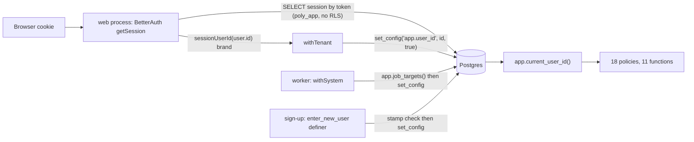

# POLY-145 — the identity path as built

Author: architect. Read from the tree at `eb7d195` (branch `feature/poly-145-identity-trust-boundary`), 2026-11-12. Every claim cites a file and line; where the docs say something different, §8 lists it.

## 1. One-paragraph summary

Postgres learns who the user is from one transaction-local setting, `app.user_id`, read through one function, `app.current_user_id()`. Three code paths write the setting: `withTenant` in the web process (poly_app), `withSystem` in the worker (poly_worker, no caller yet), and the definer `app.enter_new_user` during sign-up. Nothing in Postgres checks the value: any role that can open a transaction can call `set_config('app.user_id', <any uuid>, true)`, and the pgTAP suite does exactly that as poly_worker (`tests/db/pgtap/06_operator_invitation.sql:86`). The value written by `withTenant` comes from BetterAuth's `getSession`, which runs inside the web process and reads the `session` table as poly_app, a table poly_app can read in full, tokens included.

## 2. Roles, logins and grants

| Role | Login | Notes | Source |
|---|---|---|---|
| poly_owner | no | owns schema objects; migrator reaches it by SET ROLE only | `packages/db/sql/roles.sql:12,46-47` |
| poly_migrator | yes | INHERIT FALSE membership in owner and definer roles | `roles.sql:13,46-47` |
| poly_app | yes | web process | `roles.sql:14` |
| poly_worker | yes | worker process and the operator CLI | `roles.sql:15` |
| poly_authz, poly_purge, poly_rollup, poly_graph, poly_stake, poly_govern, poly_journal | no | definer owners | `roles.sql:16-22` |
| poly_backup | yes | the only BYPASSRLS role; read-only, `pg_read_all_data` | `roles.sql:34-42` |

Every role is `NOSUPERUSER NOCREATEDB NOCREATEROLE NOREPLICATION NOBYPASSRLS` except poly_backup (`roles.sql:28-30`). `pg_hba.prod.conf:5-7` admits poly_app, poly_worker and poly_migrator from the whole app subnet `10.201.1.0/24` with scram; the subnet holds web, worker and migrate (`infra/compose/prod.yml:139-142`), so the boundary between the two runtime roles is the password file, not the network.

poly_app on BetterAuth's tables (no RLS on any of them):
- `user`: SELECT all columns, all rows; INSERT/UPDATE on a column list without `second_step_at`, `signup_txid` (`migrations/0001_app_foundation.sql:25-26`, `0005_auth_second_step_grants.sql:5-7`).
- `session`: SELECT, DELETE; INSERT/UPDATE on a column list without `recent_auth_at` (`0001:27`, `0005:8-10`). The token is stored in the clear (SECURITY R-12, measured on 1.7.18).
- `account`, `verification`, `two_factor`, `passkey`: SELECT, INSERT, UPDATE, DELETE (`0001:27`, `0005:11`).

poly_app and poly_worker on tenancy tables: SELECT on `entity`, `membership`, `notification`, `audit_event`, a column subset of `invitation` and `entity_type` (`0003_tenancy_rules.sql:297-300`); only poly_app holds writes (`0003:301-308`). poly_worker has no grant on any BetterAuth table.

## 3. Where `app.user_id` is written

| # | Writer | Process / role | Where the value comes from | Guard | Source |
|---|---|---|---|---|---|
| W1 | `withTenant(userId, sessionId, fn)` | web / poly_app | BetterAuth `getSession` → `sessionUserId()` brand | UUID regex; the brand constructor is importable by packages/auth alone (`layers.json:7`) | `packages/db/src/context.ts:157-162`, `session.ts:7-9`; callers `packages/auth/src/handler.ts:99`, `session.ts:54,135-139` |
| W2 | `withSystem(job, target, fn)` | worker / poly_worker | `app.job_targets(job)` row | job-name regex; exactly one principal | `context.ts:170-181`; `app.job_targets` body returns no rows today (`0001:35-41`); no production caller exists (`apps/worker/src/main.ts:32`, the loop is idle) |
| W3 | `app.enter_new_user(uuid)` definer, owner poly_authz | web / poly_app, inside `withContextFreeTx` | the user row inserted by this transaction | `signup_txid = pg_current_xact_id()` stamp, no context already set, no Person yet; once per transaction | `0007_invitation_definers.sql:28-46`; `context.ts:124-135`; `new-user.ts:5-7` |
| — | `set_config` by any caller | any role | anything | **none in Postgres**; lint refuses only the session-scope forms | `tests/layers/fixtures/08-postgres-driver/pass-set-config-local.ts` passes; `fail-set-config-false.ts`, `fail-set-local-role.ts` fail |

Related settings: `app.session_id` is set beside W1 (`context.ts:160`); `app.actor` is set by W2 and by `withOperatorTx` (`context.ts:179,199`). `withContextFreeTx` and `withOperatorTx` assert the setting is empty first (`context.ts:184-200`). The four wrappers refuse to nest (`context.ts:104-105`).

## 4. Where it is read

`app.current_user_id()` (`0001:17-21`): `nullif(current_setting('app.user_id', true), '')::uuid`, invoker, EXECUTE to poly_app, poly_worker and all seven definer roles. A catalog test refuses any policy that reads `current_setting` itself (`tests/db/pgtap/02_rls_catalog.sql:44,148-177`), and another pins the function body (`01_roles.sql:86`). **This is the one seam every option can change**: every policy and definer reads identity through this function.

Functions that read it (11): `has_role`, `visible_entities`, `owner_count` (`0003:23-51`), `check_entity` (`0003:65`), `seat_creator` (`0003:104-107`), `audit_membership` (`0003:116-128`), `gate_owner_changes` (`0003:187`), `enter_new_user` (`0007:33`), `claim_invitations`, `accept_invitations` (`0009:83,103`), `issue_operator_invitation` (`0009:39`).

Policies that read it, directly or through `has_role` / `visible_entities` (18): 15 in `0003:259-294` (entity select/insert/update; membership select/update/delete/seat; invitation select/insert/update; notification select/update; audit_event select; entity_type select/insert), `invitation_govern_update` and `membership_accept_viewer` (`0007:16-20`), `invitation_operator_issue` (`0009:13-15`).

Outside SQL: `packages/auth/src/session.ts:103-127` filters the RLS-less `session` table by `app.current_user_id()` and reads `app.session_id` to mark the current session.

## 5. How a session is checked

1. `apps/web/src/hooks.server.ts:37` calls `loadSession`; `/api/auth/*` goes to `handleAuthRequest` (`hooks.server.ts:29-34`).
2. `auth.api.getSession` (`packages/auth/src/session.ts:59`, `handler.ts:85`) runs outside any transaction of ours, so the routing pool sends its query to the plain poly_app pool (`routing-pool.ts:130-131,138-139`). BetterAuth looks the session up by token. `cookieCache` is off (`options.ts`, session block), so every request hits the table.
3. The 30-day cap is ours (`session.ts:65-68`, `handler.ts:87-96`).
4. The user id is branded and passed to `withTenant` (`session.ts:69-72`). The page's queries, and any BetterAuth statements in a signed-in auth request, run in that transaction (`handler.ts:97-100`; routing pool turns BEGIN/COMMIT into savepoints, `routing-pool.ts:62-78`).

Postgres never sees the token inside the tenant transaction; it sees only the id the web process chose. The auth secret signs the cookie and encrypts TOTP seeds, backup codes and OAuth tokens (SECURITY secrets table, measured on 1.7.18).

## 6. Operator path

`polycarpic cli user invite` (`apps/worker/src/cli/main.ts`, `user-invite.ts:27`) runs `withOperatorTx` on the poly_worker pool (`context.ts:195-200`): it asserts no user, sets `app.actor = 'operator:cli'`. `app.issue_operator_invitation` (owner poly_govern, EXECUTE poly_worker alone) refuses any user context and writes its own actor literal (`0009:27-73`). It holds identity power only in the negative: it needs `app.user_id` empty.

## 7. What each shipped issue put on the path

| Issue | What it built on the identity path | Files |
|---|---|---|
| POLY-83 (foundation, for reference) | roles, `app.current_user_id()`, `withTenant` / `withSystem`, `app.job_targets` stub | `roles.sql`, `0001`, `context.ts` (first two wrappers), `pool.ts` |
| POLY-62 (foundation) | the 15 tenancy policies and 8 functions keyed on `current_user_id()` | `0002`, `0003` |
| **POLY-86** | BetterAuth in the web process on the routing pool (153 lines), the handler that picks the transaction kind, the session loader that brands the id, the 30-day cap, Sessions list/revoke, poly_app's column grants on `session`/`user` | `packages/auth/src/*` (≈1,000 lines incl. tests), `0004`, `0005`; tests `tests/db/auth-{routing-pool,route-policy,session,fields,signup-wrap,second-step,client-ip}.test.ts` |
| **POLY-87** | the second identity-assertion path: the sign-up stamp, `enter_new_user`, the `enterNewUser` handle method, claim/accept definers, the set-once and email-fixed triggers | `0006`, `0007`, `context.ts:124-135`, `new-user.ts`, `packages/auth/src/user-hooks.ts`, `packages/tenancy/src/invitation.ts`; tests `auth-new-user-step`, `auth-signup-invite`, pgTAP `05` |
| **POLY-142** | the fourth wrapper, `withOperatorTx`, on poly_worker; the issuer definer that requires an empty identity; the bootstrap predicate in claim/accept | `0008`, `0009`, `context.ts:191-200`, `db/src/operator.ts`, `apps/worker/src/cli/*`, `tenancy/src/operator-invitation.ts`; tests `operator-invite`, pgTAP `06` |

Test coupling to the mechanism (count of lines that call a wrapper, `set_config('app.user_id'…)`, or `SET LOCAL ROLE`): `tests/db/wrappers.test.ts` 32, pgTAP `05` 39, pgTAP `06` 25, `auth-new-user-step` 12, the rest under 10 each; ≈150 lines in 18 files. These are the tests a change of mechanism rewrites; the RLS and battery tests mostly call helpers and move with them.

## 8. Where the code and the docs disagree

1. **The worker holds the BetterAuth secret.** `packages/config/src/registry.ts:17` makes `AUTH_SECRET_FILE` required for `worker`, and `infra/compose/prod.yml:72,76` mounts it. SECURITY's secrets table names web as its only consumer. Nothing in `apps/worker` uses it. With it, a worker compromise can decrypt TOTP seeds and OAuth tokens it reads from a backup or dump, and sign cookies for any token it learns. Whichever option wins, it should leave the worker.
2. **Routing pool size and scope.** ARCH §3.1c calls it "about 30 lines" that route "inside withTenant"; `packages/auth/src/routing-pool.ts` is 153 lines and routes into `withContextFreeTx` (and `withOperatorTx`) too; only `withSystem` is refused (`routing-pool.ts:132`).
3. **Who reads `app.session_id`.** ARCH §3.3 says only the email-challenge definers and enrolment guards read it; those land with POLY-89, and today the only reader is TS-issued SQL in `packages/auth/src/session.ts:106,114,118`.
4. **R-2's worker reasoning.** R-2 says a job's principal "comes from app.job_targets() in the same process". `app.job_targets` returns no rows (`0001:39`) and nothing calls `withSystem`, so today the worker has no legitimate path that sets `app.user_id`. Its reach under a forged setting is read-only on six tenancy tables (`0003:297-300`); that grows when import and ledger give poly_worker write policies.
5. **The brand is a type, not a boundary.** A-39 presents `SessionUserId` as the way identity enters `withTenant`. Inside any transaction, any package holding a `Tx` can run `set_config('app.user_id', …, true)`; lint passes it (§3). The brand stops an accidental call, not a hostile one; R-2 already says so for injection.
6. **Known, owned elsewhere:** compose sets `DB_PASSWORD_FILE` (`prod.yml:48,71`) where `connection.ts:9` requires `DATABASE_PASSWORD_FILE` (POLY-97).

## 9. Facts the options turn on

- One function body (`app.current_user_id()`) is the read side of every policy. Changing *how identity is established* need not touch the 18 policies.
- poly_app can read every live session token in the clear. Any design where Postgres verifies a session token is void while poly_app keeps SELECT on `session`; BetterAuth must then leave poly_app.
- BetterAuth's signed-in writes (TOTP enrol, passkey register, session rotation) currently ride the tenant transaction so that POLY-89's guards see `app.session_id` (ARCH §3.1c, A-31). Moving sign-in to another process breaks that coupling, and POLY-89's guard design is built on it.
- The worker sets identity in exactly one place (`withSystem`), which has no caller yet: the worker side is cheapest to change now.
